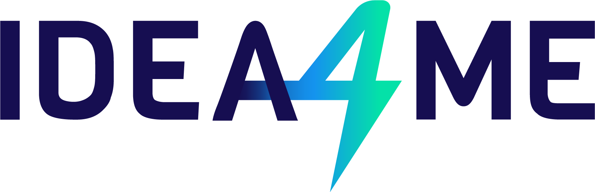

<b>AI, automation, digital marketing and IT for small and medium-sized businesses</b> 
<b>AI, automatyzacja, marketing cyfrowy i IT dla małych i średnich firm</b> 
<a href="https://idea4me.pl">idea4me.pl</a> · <a href="https://cybulski.ai">cybulski.ai</a> · <a href="mailto:biuro@idea4me.pl">biuro@idea4me.pl</a>

---

**IDEA4ME.PL Spółka z ograniczoną odpowiedzialnością** 
ul. Składowa 5, 62-023 Żerniki 
KRS 0001251289 · NIP 777-347-19-52 · REGON 545055625 
Sąd Rejonowy Poznań - Nowe Miasto i Wilda w Poznaniu, IX Wydział Gospodarczy Krajowego Rejestru Sądowego 
Kapitał zakładowy: 5 000,00 zł
